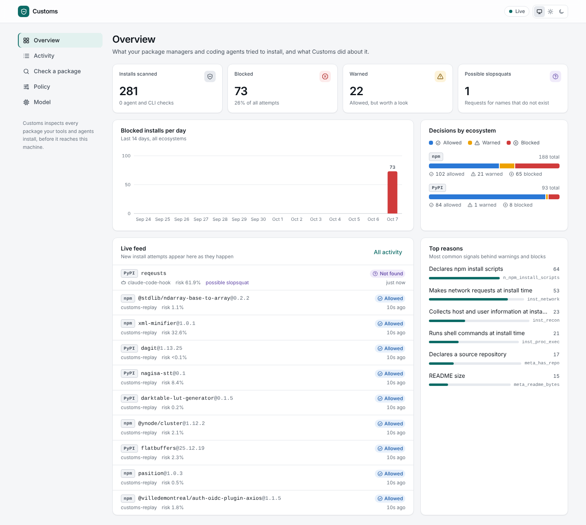
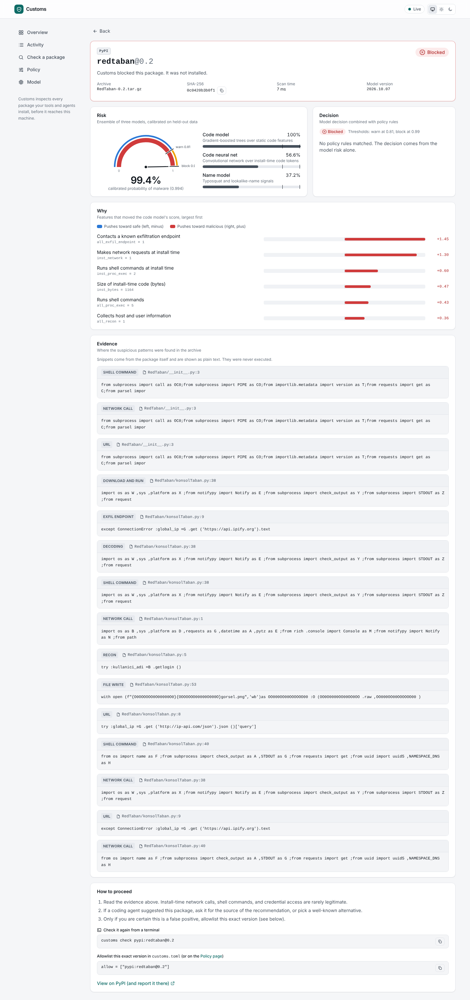

# Customs

**A package firewall for AI coding agents.** Customs sits between `pip`/`uv`/`npm` (and
agents like Claude Code that run them on your behalf) and the public registries. It
inspects every package archive before it reaches your machine, scores it with a malware
classifier trained on real malicious packages from two independent collections, and blocks
what looks dangerous.
Packages that do not exist (the names an LLM hallucinates and attackers then register)
are stopped before anything is downloaded.



**On malware discovered after its training data** (time-split test set of 8,317 packages):

| | Customs | GuardDog 3.2 |
|---|---:|---:|
| ROC AUC | **0.974** | 0.837 |
| Malware caught at GuardDog's own false-positive rate (18%) | **96.4%** | 79.4% |
| Malware caught at GuardDog's `high_risk` false-positive rate (5%) | **88.6%** | 49.7% |
| Malware flagged (warn) at a 0.6% false-positive rate | **78.6%** | |
| Malware caught at exactly a 0.1% false-positive rate | **70.5%** | |
| Malware auto-blocked at a 0.05% false-positive rate | **63.4%** | |

The Rust binary reproduces the offline evaluation exactly: replaying 706 held-out packages
through the live proxy gave identical decisions to the Python pipeline (largest risk
difference 1e-7) at about 50 ms per package. Under load, 16 concurrent clients get 66
cold scans a second (median 25 ms) and 772 cached verdicts a second. Full report:
[`docs/EVALUATION.md`](docs/EVALUATION.md).

## Why this exists

Coding agents now install dependencies on their own. That opens two holes:

1. **Malicious packages.** Over 230,000 malicious npm and PyPI packages have been reported
   to the OSSF malicious-packages database. Most run their payload at install time
   (`setup.py`, npm `postinstall`) and steal credentials before anyone reads the code.
2. **Slopsquatting.** LLMs suggest plausible packages that do not exist; attackers
   register those names. An agent that trusts its own suggestion installs the attacker's
   code.

Vulnerability scanners (CVE databases) say nothing about a brand-new malicious upload, and
open-source malware scanners are rule sets. Customs adds a learned detector, registry
policy rules, and a direct hook into the agent, in one local binary.

## How it works


* **Scanner** (`crates/customs-scan`): unpacks sdists, wheels and npm tarballs in memory with
  zip-bomb, traversal and symlink defenses; a hand-written lexer for Python, JavaScript
  and shell finds what the code does at install and import time (process execution,
  network calls, credential paths, exfiltration endpoints, obfuscation, persistence) and
  emits 77 features plus a normalized token stream. Training and serving call this same
  code, so there is no train/serve skew.
* **Models** (`python/customs_ml`, inference in `crates/customs-model`): a LightGBM model over
  the features, a 1D CNN (PyTorch) over install-time tokens, and a package-name model for
  typosquats. A stacked, calibrated ensemble gives one risk score. All of it is exported
  to plain JSON and evaluated in Rust (no Python or native ML runtime at serve time), with
  parity tests pinning Rust to the Python reference.
* **Firewall** (`crates/customs`): an async (tokio + axum) PyPI and npm registry proxy with a
  single-flight scan cache, a TOML policy engine, a REST + Server-Sent Events API,
  Prometheus metrics, and the Claude Code hook.
* **Dashboard** (`web/`): React + TypeScript. Live install feed, verdict explanations with
  per-feature contributions and code evidence, a package checker, and policy editing.

## Quick start

```sh
cargo install --path crates/customs        # or: docker compose -f deploy/docker-compose.yml up
customs serve                              # proxy, API and dashboard on http://127.0.0.1:7878
eval "$(customs env)"                      # route pip, uv, pipenv, PDM, npm, pnpm, Yarn, Bun and Deno through it
customs doctor                             # find installs in this project that would still skip the proxy

customs check pypi reqeusts                # BLOCK: does not exist, 1 edit from 'requests'
customs check npm left-pad                 # ALLOW
customs scan ./some-package-1.0.tgz        # offline verdict for a local archive
```

**Claude Code:** merge [`hooks/claude-code-settings.json`](hooks/claude-code-settings.json)
into `~/.claude/settings.json`. Before the agent runs any shell command, the hook finds
package installs in it (`pip install`, `uv add`, `npm i`, `npx`, requirement files,
chained commands) and denies the command when a package is blocked, with the reason, so
the agent stops and asks you. Project installs (`npm ci`, `npm install`, `uv sync`,
`poetry install` and the rest) are checked against the project's lockfile, plus any
dependency added to the manifest but not locked yet. See [`hooks/README.md`](hooks/README.md).

`scripts/demo.sh` runs the whole tour against the live registries.

### Beyond the proxy

**Agents over MCP.** `customs mcp` is a Model Context Protocol server, so any MCP client
can ask before it installs: `claude mcp add customs -- customs mcp`. Tools:
`check_package`, `check_install_command` (parses a whole shell command),
`explain_verdict`, `audit_lockfile` (every pin in a lockfile, including entries whose
download URL serves another package) and `scan_archive`. Evidence quoted from package code is marked as
untrusted data and cut to one bounded line, so a malicious package cannot use its own
source to prompt-inject the agent reading the verdict. See [`hooks/README.md`](hooks/README.md).

**Lockfiles in CI.** `customs audit` checks every pin in `requirements.txt`, `poetry.lock`,
`uv.lock`, `Pipfile.lock`, `package-lock.json`, `pnpm-lock.yaml`, `yarn.lock`, `bun.lock` and `deno.lock`,
and can write SARIF 2.1.0 for GitHub code scanning. It also blocks lockfile injection for
npm, Yarn, pnpm, Bun and Deno: an entry whose tarball URL serves a different package than the
name the diff shows. The composite action in [`action.yml`](action.yml)
turns blocked dependencies into alerts on the lockfile line in the pull request:

```sh
customs audit -r --fail-on warn                       # whole repo; exit 1 on warn or block
customs audit -r --format sarif -o customs.sarif      # see docs/github-action.md
```

**Release history rules.** Account takeovers show up in registry metadata before anyone
reads the code. The policy engine compares each release with the ones before it and flags
provenance disappearing (npm and PyPI), an install script appearing or changing, a new
publisher, a project waking up after a year of silence, a new dependency fetched from git or
a URL, or a new dependency that strangers published days before the release
(`docs/DESIGN.md`, section 8). The install script and dependency rules block by default, and each compares a release
with the one before it and with the newest release at least a day older, so a burst of
malicious versions published within hours cannot hide the change. Together they fired on 5
of 14,897 legitimate releases and lift the share of test-period compromised npm releases
blocked from 44% to at least 96%: of 17 groups of three or more releases (one npm scope or
name prefix each), 15 are blocked in full. The rest warn.

## Results

| Test set (time split, malware found from 2026-02-13) | Value (95% CI) |
|---|---|
| ROC AUC | 0.974 (0.969 to 0.979) |
| Flagged at the warn threshold (target FPR 1%) | 78.6% (75.4 to 81.9), realized FPR 0.64% |
| Blocked at the block threshold (target FPR 0.1%) | 63.4% (59.2 to 67.4), realized FPR 0.05% |
| Caught at exactly 0.1% FPR on the test ROC (threshold-free) | 70.5% (55.2 to 75.3) |
| Never-seen campaigns (no near-duplicate in training), ROC AUC | 0.974 |
| Benign false positives at block, popular packages | 0 of 2,064 (top and mid tiers) |
| Registry-confirmed malware (the registry removed the version), blocked | 71.8% of 3,396, ROC AUC 0.979 |

**Label check.** The malware labels come from a collector's analysis. npm and PyPI remove
confirmed malware within days, and 704 of the 4,100 flagged test versions were still
published in October 2026. That group mixes proof-of-concept and dependency-confusion
probes the registry left up with collector false positives: 117 of the 155 "binary-only"
test samples, once the model's worst blind spot, are per-platform prebuilt binaries such
as `bare-build-win32-x64` that are still served. The model blocks 23.0% of the
still-published group and 71.8% of the removed one.



**Red team.** Held-out malware rewritten with evasions, then re-scanned. The first model
leaned on metadata (an ablation without it drops ROC AUC from 0.976 to 0.941), so training
was augmented with disguised malware; the string rewrites were never trained on, and each
one that cost detection led to a scanner pass that reads the string the way the runtime
would. Detection at the block threshold, against 60.9% for the clean samples:

| Evasion | Used in augmentation | Before the scanner fix | Now |
|---|---|---:|---:|
| starjacking (README, repo link and description copied from a real project) | yes | 11-point gap | 66.1% |
| fake README and repository metadata | yes | n/a | 53.4% |
| payload buried inside a real library's source | yes | n/a | 54.6% |
| literals split into `+` concatenations | no | 4-point gap | 60.4% |
| literals written as `\xNN` escapes | no | 6.5-point gap | 61.4% |
| literals stored reversed (`'...'[::-1]`) | no | 6.7-point gap | 60.2% |
| literals split into joined lists (`''.join([...])`) | no | 7.8-point gap | 60.1% |
| literals moved into one string table (`_s[3]`) | no | 2.8-point gap | 59.8% |
| literals built from character codes | no | n/a | 58.8% |
| install script moved behind an import | no | n/a | 60.9% |
| payload wrapped in base64 + exec | no | n/a | 78.8% |
| payload wrapped in zlib + base64 + exec | no | n/a | 76.2% |

The wrapped payloads score higher than clean ones because the scanner decodes the literal
handed to `exec` or `eval` (plain, base64, or zlib inside base64, within a per-file budget)
and reads it as code, while the encoded blob itself still counts as obfuscation.
Starjacked copies are now caught more often than clean ones: the scanner flags a
repository link that names a different project than the package, which a copied link
always does. Training also sees copies whose link is renamed after the package itself,
so a matching link is not read as proof of a real project.

**A second source.** The test sets above hold one collector's malware.
[MalRegistry](https://github.com/lxyeternal/pypi_malregistry) (ASE 2023) was gathered by
another team. Its samples with no name or near-duplicate in the training data are split by
campaign into a dev half and a held-out half that is never looked at or trained on:

| Held-out MalRegistry campaigns (2,174 archives, 660 clusters) | Before | After |
|---|---:|---:|
| Caught at a 0.5% false-positive rate (code only, no name model) | 37.4% | **48.7%** |
| Warned or blocked, one sample per campaign | 59.2% | **81.7%** |

*Before* is the model trained on one collector; *after* adds the dev half to training (the
first row is a controlled retrain; the second is the shipped model). The gain grows with
the share of dev campaigns added (43.0% at a quarter, 46.1% at half). A round of scanner
fixes driven by dev-half error analysis, by contrast, helped the dev half and barely moved
the held-out one, which is why the held-out half exists.

Weighting each campaign equally, the shipped models catch 67.7% / 79.9% / 83.1% of held-out
campaigns at 0.1% / 0.5% / 1% false positives. Per-archive numbers are fragile here: one
campaign is 901 near-identical archives (41% of the held-out half) with a code risk near
0.91, so per-archive recall moves by 41 points whenever a retrain carries that one score
across a threshold. At 0.5% it read 91.1% for the previous model and 65.4% for this one,
while the campaign-weighted number moved from 81.0% to 79.9%.

**Known weak spots** (from the report): compromised releases of popular libraries (a
payload inside thousands of lines of legitimate code, ROC AUC 0.913, 39% blocked) and very
large packages. Blocking of compromised releases rose from 31% to 46% once the scanner
parsed `bun run index.js` correctly and followed hooks that call other scripts
(`npm run setup`); retrains with different seeds block between 36% and 43% of them, so
single-run differences of a few points there are noise. Error analysis of missed takeovers
raised their ROC AUC from 0.852 to 0.901: npm installs a package with a `binding.gyp` by
running node-gyp, which executes commands embedded in that file, and an archive layout that
bundles the published wheel beside a clean source checkout had the scanner reading the clean
copy. Packages whose payload is a
compiled binary are the largest group of misses with no code signal, and strings inside
those binaries do not separate malware from benign native modules. The policy rules
(minimum package age, install scripts in new packages, release history) are the backstop.

The full report, with every slice, the ablation, calibration and the GuardDog
methodology, is in [`docs/EVALUATION.md`](docs/EVALUATION.md).

### How the evaluation avoids fooling itself

* **Real data, both classes.** 20,488 malicious archives from
  [Datadog's malicious-software-packages-dataset](https://github.com/DataDog/malicious-software-packages-dataset),
  11,630 from MalRegistry (half of its campaigns held out for testing only),
  and 22,258 benign archives downloaded from PyPI and npm across popularity tiers,
  filtered against all 234K OSSF reports.
* **Identical packaging.** Both classes are repacked into the same deterministic tarball
  format before scanning, so archive quirks cannot leak the label.
* **Campaign-aware.** MinHash LSH clusters near-duplicate packages (one worm can publish
  hundreds of copies). Clusters drive splits, sample weights and every confidence
  interval (cluster bootstrap).
* **Time-split.** Test malware was discovered after everything the model trained on, which
  is what a deployed firewall faces. A "novel campaigns" slice isolates test malware with
  no relative in training.
* **Frozen thresholds.** Block and warn thresholds are picked on validation for 0.1% and 1%
  false-positive rates, then applied to test unchanged. At 0.1% that rests on two or three
  validation packages, and an earlier model's threshold landed at 0.02% FPR on test with
  10 points of recall lost. The cause was a few benign packages with extreme CNN logits;
  the stacker now bounds each component's logit, with the bound chosen on validation, and
  the realized FPR sits between 0.05% and 0.17% across recent retrains, close to the 0.07%
  to 0.31% spread of a five-seed study. The threshold-free row (detection at exactly 0.1%
  FPR on the test ROC) separates what the model learned from where the threshold landed.
  Smoother quantile estimates (Harrell-Davis, an exponential tail fit) did not change
  that: over 400 bootstrap resamples of validation campaigns, all three land near 0.05% on
  test, because benign validation packages have a heavier score tail than benign test
  ones. None of the top-scoring benign packages has been pulled from its registry, and no
  benign package in the corpus shares a name with an OpenSSF malware report.
* **Red-teamed.** Held-out malware is rewritten with evasions and re-scanned; evasions used
  in augmentation are reported separately from unseen ones.
* **Verified end to end.** `scripts/replay.py` serves held-out malware from a fake
  registry and requests it through the real binary. It caught four train/serve skews
  that unit tests missed (a name-encoding label leak in the source data, CNN pooling over
  batch padding, the CNN skipped on empty token streams in Rust, and a feature derived
  from the archive file name); after the fixes the binary matches the evaluation to 1e-7.
* **Seed noise measured.** Five retrains that differ only in random seed give ROC AUC
  0.968 to 0.969 but block recall 61% to 70%, because the block threshold rests on two or
  three validation packages. Model changes are judged against that spread. One scanner
  fix (re-rooting packages nested beside a source checkout) lowered the headline from
  0.972 to 0.969: scoring the old and new models on the corrected features gives 0.969
  for both, so the earlier number had been helped by archives the old scanner misread.

## Repository layout

| Path | What |
|---|---|
| `crates/customs-scan` | Archive unpacking and feature extraction (library, CLI, Python bindings via PyO3 in `crates/customs-py`) |
| `crates/customs-model` | Inference: tree ensemble with Saabas attributions, CNN forward pass, name model, stacking |
| `crates/customs` | The `customs` binary: proxy, policy, API, hook, CLI |
| `python/customs_ml` | Dataset build, dedup, splits, training, evaluation, robustness, export |
| `web/` | Dashboard |
| `models/` | Trained artifacts (JSON) and parity fixtures |
| `deploy/` | Docker Compose with Prometheus, Kubernetes manifests |
| `docs/` | [Design](docs/DESIGN.md), [evaluation](docs/EVALUATION.md) |

## Development

```sh
cargo test --workspace && cargo clippy --workspace --all-targets -- -D warnings
cd python && pip install -e ".[dev,nn]" && pytest
cd web && npm ci && npm run lint && npm run test && npm run e2e
```

Rebuilding the dataset and models from scratch (downloads about 9 GB, a few hours on
4 cores; everything lands in `$CUSTOMS_DATA`, never in the repository):

```sh
cd python && pip install -e ".[nn]"
git clone --depth 1 https://github.com/ossf/malicious-packages /tmp/ossf
customs-ml ossf --repo /tmp/ossf
customs-ml malicious && customs-ml benign && customs-ml names
cargo build --release -p customs-scan       # the scanner the pipeline calls
customs-ml train && customs-ml report       # trains, evaluates, red-teams, exports to models/
```

## Safety

Malware samples are never executed, imported or installed: analysis is static, archives
are read in memory, and no sample is stored in this repository (only numeric features'
trained models and aggregate metrics). Datadog's dataset is Apache-2.0; OSSF
malicious-packages is Apache-2.0.

The scanner itself faces attacker-chosen bytes, so it is fuzzed: a structure-aware
mutation fuzzer (`cargo run --release -p customs-scan --example fuzz`) mutates real corpus
archives at the byte, tar-header and file-content levels. It found two code paths that made
a scan super-linear (one input took 8 minutes); after the fixes, 514K mutated archives in 20
minutes produced no panic and no slow scan, and corpus scanning got 4.2x faster. Details
in [DESIGN.md section 4.8](docs/DESIGN.md#48-hostile-inputs).

What the scanner cannot read, it cannot judge, so unread code fails closed. Padding
`setup.py` past the 32 MiB per-file limit dropped a test payload's risk from 1.00 to 0.59,
and 20,001 empty files made any archive unscannable; both now block (`unread_code`,
`scan_error`), and neither fires on any of the 22,258 benign corpus archives. The same
rule covers wheel entries the scanner cannot decode (encrypted, or compressed with a
method it lacks) and install hooks in archives above the 256 MiB scan limit, which are
read by streaming the archive's headers. See
[DESIGN.md section 4.7](docs/DESIGN.md#47-archive-handling).

A `.pth` file runs at every Python start, not only at install, so a `.pth` file that
launches a process, connects out, downloads or reads secrets blocks on its own
(`startup_hook`). Across 58K scanned archives one appears in 19 malicious packages and no
benign one; it catches litellm 1.82.8, whose 52 MB of real library code drowns the model's
score.

## License

MIT
