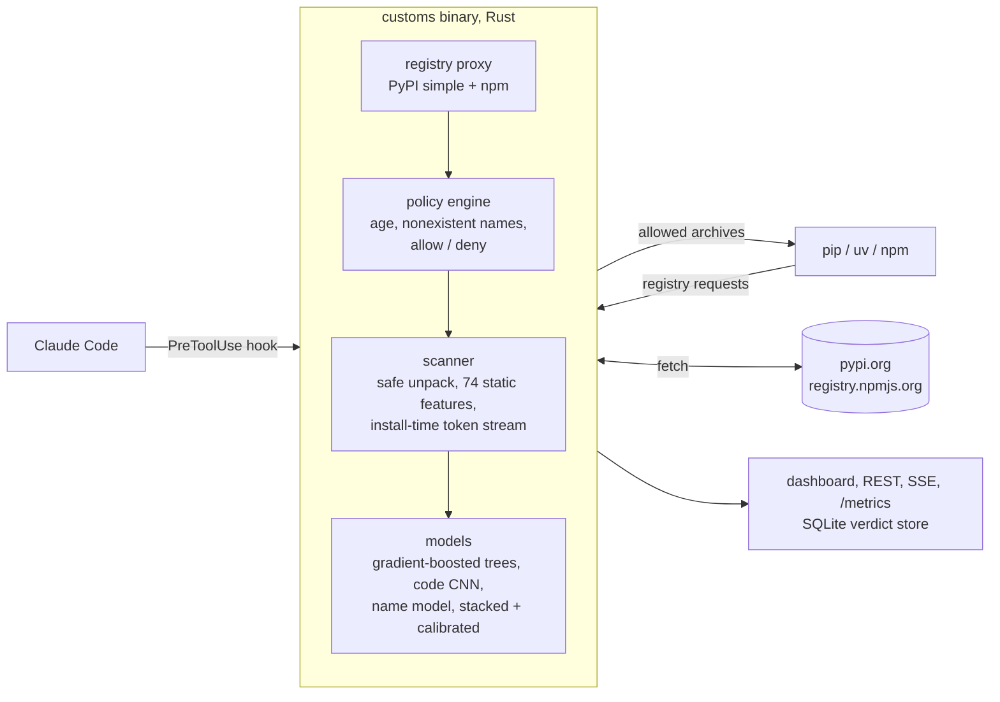

# Customs

**A package firewall for AI coding agents.** Customs sits between `pip`/`uv`/`npm` (and
agents like Claude Code that run them on your behalf) and the public registries. It
inspects every package archive before it reaches your machine, scores it with a malware
classifier trained on 20,000 real malicious packages, and blocks what looks dangerous.
Packages that do not exist (the names an LLM hallucinates and attackers then register)
are stopped before anything is downloaded.


**On malware discovered after its training data** (time-split test set of 8,317 packages):

| | Customs | GuardDog 3.2 |
|---|---:|---:|
| ROC AUC | **0.972** | 0.837 |
| Malware caught at GuardDog's own false-positive rate (18%) | **95.1%** | 79.4% |
| Malware caught at GuardDog's `high_risk` false-positive rate (5%) | **86.5%** | 49.7% |
| Malware flagged (warn) at a 0.8% false-positive rate | **78.9%** | |
| Malware auto-blocked at a 0.02% false-positive rate | **57.4%** | |

The Rust binary reproduces the offline evaluation exactly: replaying 706 held-out packages
through the live proxy gave identical decisions to the Python pipeline (largest risk
difference 1e-7) at about 50 ms per package. Full report:
[`docs/EVALUATION.md`](docs/EVALUATION.md).

## Why this exists

Coding agents now install dependencies on their own. That opens two holes:

1. **Malicious packages.** Over 230,000 malicious npm and PyPI packages have been reported
   to the OSSF malicious-packages database. Most run their payload at install time
   (`setup.py`, npm `postinstall`) and steal credentials before anyone reads the code.
2. **Slopsquatting.** LLMs suggest plausible packages that do not exist; attackers
   register those names. An agent that trusts its own suggestion installs the attacker's
   code.

Vulnerability scanners (CVE databases) say nothing about a brand-new malicious upload, and
open-source malware scanners are rule sets. Customs adds a learned detector, registry
policy rules, and a direct hook into the agent, in one local binary.

## How it works



* **Scanner** (`crates/customs-scan`): unpacks sdists, wheels and npm tarballs in memory with
  zip-bomb, traversal and symlink defenses; a hand-written lexer for Python, JavaScript
  and shell finds what the code does at install and import time (process execution,
  network calls, credential paths, exfiltration endpoints, obfuscation, persistence) and
  emits 74 features plus a normalized token stream. Training and serving call this same
  code, so there is no train/serve skew.
* **Models** (`python/customs_ml`, inference in `crates/customs-model`): a LightGBM model over
  the features, a 1D CNN (PyTorch) over install-time tokens, and a package-name model for
  typosquats. A stacked, calibrated ensemble gives one risk score. All of it is exported
  to plain JSON and evaluated in Rust (no Python or native ML runtime at serve time), with
  parity tests pinning Rust to the Python reference.
* **Firewall** (`crates/customs`): an async (tokio + axum) PyPI and npm registry proxy with a
  single-flight scan cache, a TOML policy engine, a REST + Server-Sent Events API,
  Prometheus metrics, and the Claude Code hook.
* **Dashboard** (`web/`): React + TypeScript. Live install feed, verdict explanations with
  per-feature contributions and code evidence, a package checker, and policy editing.

## Quick start

```sh
cargo install --path crates/customs        # or: docker compose -f deploy/docker-compose.yml up
customs serve                              # proxy, API and dashboard on http://127.0.0.1:7878
eval "$(customs env)"                      # route pip, uv and npm through it

customs check pypi reqeusts                # BLOCK: does not exist, 1 edit from 'requests'
customs check npm left-pad                 # ALLOW
customs scan ./some-package-1.0.tgz        # offline verdict for a local archive
```

**Claude Code:** merge [`hooks/claude-code-settings.json`](hooks/claude-code-settings.json)
into `~/.claude/settings.json`. Before the agent runs any shell command, the hook finds
package installs in it (`pip install`, `uv add`, `npm i`, `npx`, requirement files,
chained commands) and denies the command when a package is blocked, with the reason, so
the agent stops and asks you. See [`hooks/README.md`](hooks/README.md).

`scripts/demo.sh` runs the whole tour against the live registries.

### Beyond the proxy

**Agents over MCP.** `customs mcp` is a Model Context Protocol server, so any MCP client
can ask before it installs: `claude mcp add customs -- customs mcp`. Tools:
`check_package`, `check_install_command` (parses a whole shell command),
`explain_verdict` and `scan_archive`. Evidence quoted from package code is marked as
untrusted data and cut to one bounded line, so a malicious package cannot use its own
source to prompt-inject the agent reading the verdict. See [`hooks/README.md`](hooks/README.md).

**Lockfiles in CI.** `customs audit` checks every pin in `requirements.txt`, `poetry.lock`,
`uv.lock`, `Pipfile.lock`, `package-lock.json`, `pnpm-lock.yaml` and `yarn.lock`, and can
write SARIF 2.1.0 for GitHub code scanning. The composite action in [`action.yml`](action.yml)
turns blocked dependencies into alerts on the lockfile line in the pull request:

```sh
customs audit -r --fail-on warn                       # whole repo; exit 1 on warn or block
customs audit -r --format sarif -o customs.sarif      # see docs/github-action.md
```

**Release history rules.** Account takeovers show up in registry metadata before anyone
reads the code. The policy engine compares each release with the ones before it and warns
when npm provenance disappears, an install script appears or changes, the publisher is new,
or a project wakes up after a year of silence (`docs/DESIGN.md`, section 8).

## Results

| Test set (time split, malware found from 2026-02-13) | Value (95% CI) |
|---|---|
| ROC AUC | 0.972 (0.967 to 0.977) |
| Flagged at the warn threshold (target FPR 1%) | 78.9% (75.7 to 82.1), realized FPR 0.76% |
| Blocked at the block threshold (target FPR 0.1%) | 57.4% (52.6 to 62.0), realized FPR 0.02% |
| Never-seen campaigns (no near-duplicate in training), ROC AUC | 0.971 |
| Benign false positives at block, popular packages | 0 of 2,064 (top and mid tiers) |


**Red team.** Held-out malware rewritten with cheap evasions, then re-scanned. The first
model leaned on metadata (an ablation without it drops ROC AUC from 0.976 to 0.941), so
training was augmented with disguised malware. Detection at the warn threshold:

| Evasion | Used in augmentation | Before | After |
|---|---|---:|---:|
| none (clean) | | 80.0% | 79.0% |
| starjacking (README, repo link and description copied from a real project) | yes | 57.9% | **74.2%** |
| fake README and repository metadata | yes | 63.2% | **76.0%** |
| payload buried inside a real library's source | yes | 68.0% | **79.2%** |
| string literals split into concatenations | no | 78.0% | 76.2% |
| install script moved behind an import | no | 79.9% | 78.9% |
| payload wrapped in base64 + exec | no | 91.6% | 93.9% |

**Known weak spots** (from the report): compromised releases of popular libraries (a
payload inside thousands of lines of legitimate code, ROC AUC 0.882) and very large
packages. The policy rules (minimum package age, install scripts in new packages) are the
backstop there.

The full report, with every slice, the ablation, calibration and the GuardDog
methodology, is in [`docs/EVALUATION.md`](docs/EVALUATION.md).

### How the evaluation avoids fooling itself

* **Real data, both classes.** 20,488 malicious archives from
  [Datadog's malicious-software-packages-dataset](https://github.com/DataDog/malicious-software-packages-dataset)
  and 22,258 benign archives downloaded from PyPI and npm across popularity tiers,
  filtered against all 234K OSSF reports.
* **Identical packaging.** Both classes are repacked into the same deterministic tarball
  format before scanning, so archive quirks cannot leak the label.
* **Campaign-aware.** MinHash LSH clusters near-duplicate packages (one worm can publish
  hundreds of copies). Clusters drive splits, sample weights and every confidence
  interval (cluster bootstrap).
* **Time-split.** Test malware was discovered after everything the model trained on, which
  is what a deployed firewall faces. A "novel campaigns" slice isolates test malware with
  no relative in training.
* **Frozen thresholds.** Block and warn thresholds are picked on validation for 0.1% and 1%
  false-positive rates, then applied to test unchanged.
* **Red-teamed.** Held-out malware is rewritten with evasions and re-scanned; evasions used
  in augmentation are reported separately from unseen ones.
* **Verified end to end.** `scripts/replay.py` serves held-out malware from a fake
  registry and requests it through the real binary. It caught four train/serve skews
  that unit tests missed (a name-encoding label leak in the source data, CNN pooling over
  batch padding, the CNN skipped on empty token streams in Rust, and a feature derived
  from the archive file name); after the fixes the binary matches the evaluation to 1e-7.

## Repository layout

| Path | What |
|---|---|
| `crates/customs-scan` | Archive unpacking and feature extraction (library, CLI, Python bindings via PyO3 in `crates/customs-py`) |
| `crates/customs-model` | Inference: tree ensemble with Saabas attributions, CNN forward pass, name model, stacking |
| `crates/customs` | The `customs` binary: proxy, policy, API, hook, CLI |
| `python/customs_ml` | Dataset build, dedup, splits, training, evaluation, robustness, export |
| `web/` | Dashboard |
| `models/` | Trained artifacts (JSON) and parity fixtures |
| `deploy/` | Docker Compose with Prometheus, Kubernetes manifests |
| `docs/` | [Design](docs/DESIGN.md), [evaluation](docs/EVALUATION.md) |

## Development

```sh
cargo test --workspace && cargo clippy --workspace --all-targets -- -D warnings
cd python && pip install -e ".[dev,nn]" && pytest
cd web && npm ci && npm run lint && npm run test && npm run e2e
```

Rebuilding the dataset and models from scratch (downloads about 9 GB, a few hours on
4 cores; everything lands in `$CUSTOMS_DATA`, never in the repository):

```sh
cd python && pip install -e ".[nn]"
git clone --depth 1 https://github.com/ossf/malicious-packages /tmp/ossf
customs-ml ossf --repo /tmp/ossf
customs-ml malicious && customs-ml benign && customs-ml names
cargo build --release -p customs-scan       # the scanner the pipeline calls
customs-ml train && customs-ml report       # trains, evaluates, red-teams, exports to models/
```

## Safety

Malware samples are never executed, imported or installed: analysis is static, archives
are read in memory, and no sample is stored in this repository (only numeric features'
trained models and aggregate metrics). Datadog's dataset is Apache-2.0; OSSF
malicious-packages is Apache-2.0.

## License

MIT
