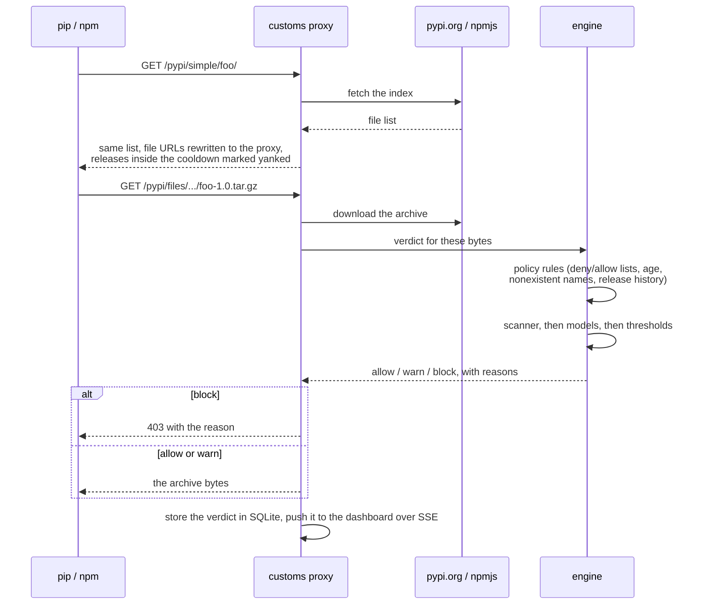
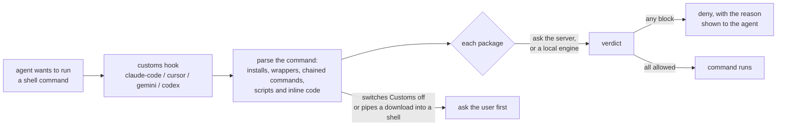
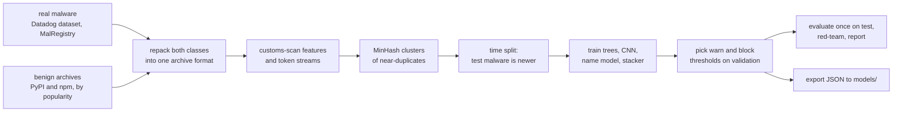

# Architecture

A five-minute tour for someone new to the code. [DESIGN.md](DESIGN.md) is the full
contract: feature names, artifact formats, HTTP routes and policy keys.

## The one-sentence version

`customs` is a single Rust binary that sits between package managers and the public
registries, scans every package archive before it is handed over, and answers allow, warn
or block from a policy engine plus a malware classifier trained offline in Python.

## The pieces

| Path | Language | Job |
|---|---|---|
| `crates/customs-scan` | Rust | Unpacks sdists, wheels and npm tarballs in memory and turns them into features plus a token stream. Training and serving both call it. |
| `crates/customs-model` | Rust | Runs the exported models: gradient-boosted trees, a 1D CNN over tokens, a package-name model, and the stacker that combines them. |
| `crates/customs` | Rust | The `customs` binary: registry proxy, policy engine, REST API, agent hooks, MCP server, lockfile audit and the CLI. |
| `crates/customs-py` | Rust | Python bindings for the scanner, so the training pipeline extracts features with the same code the proxy runs. |
| `python/customs_ml` | Python | Builds the dataset, trains and evaluates the models, and exports them to JSON in `models/`. |
| `web/` | TypeScript | The dashboard, a static React app that the binary serves. |
| `models/` | JSON | The trained models the binary loads at startup. `models/dev/` holds small placeholders for tests. |
| `deploy/` | Docker, YAML | Container image, Compose and Kubernetes files, an example policy, and the hook configs for each agent. |
| `scripts/` | Python, shell | The demo, the installer end-to-end test, the replay and load tests, and the live PyPI study. |

## What happens on `pip install foo`

Verdicts are cached by archive hash, and concurrent requests for the same archive share
one scan. In `monitor` mode the proxy records the verdict and serves the archive anyway.

## What happens when an agent runs a command

The hook never installs anything. It reads the command (and the lockfile or script the
command would use), asks for verdicts, and tells the agent what it found. The proxy is
still the layer that sees the bytes.

## How the models are made

The pipeline runs offline and writes only model files and aggregate metrics into the
repository. Malware samples stay in `$CUSTOMS_DATA`, outside the checkout, and are never
executed or installed. [EVALUATION.md](EVALUATION.md) has the numbers.

## Where state lives

| What | Where |
|---|---|
| Verdicts, events, policy change log | SQLite in the data directory (`CUSTOMS_DATA_DIR`) |
| Downloaded archives | Content-addressed cache next to the database |
| Policy | `customs.toml` (example in `deploy/customs.toml`), editable from the dashboard |
| Models | `models/` in a checkout, `CUSTOMS_MODELS` or `--models` elsewhere |

## Configuration knobs worth knowing

| Variable | Default | Effect |
|---|---|---|
| `CUSTOMS_BIND` | `127.0.0.1:7878` | Address the server listens on |
| `CUSTOMS_DATA_DIR` | `.customs` for the server, the user cache directory for the hook and CLI | Database and archive cache |
| `CUSTOMS_MODELS` | `./models`, then paths next to the binary | Model directory |
| `CUSTOMS_UI_DIR` | `./web/dist`, then paths next to the binary | Dashboard files |
| `CUSTOMS_SERVER` | `http://127.0.0.1:7878` | Server the hook and CLI talk to |
| `CUSTOMS_ADMIN_TOKEN` | unset | Required for policy changes when set |

Every flag and variable is listed by `customs serve --help`, and every variable in
[`.env.example`](../.env.example).

## Where to start reading

- `crates/customs/src/engine.rs`: one function turns archive bytes into a verdict.
- `crates/customs/src/proxy/`: the PyPI and npm routes.
- `crates/customs/src/hook/parse.rs`: how a shell command becomes a list of packages.
- `crates/customs-scan/src/indicators.rs`: what the scanner looks for in code.
- `python/customs_ml/pipeline.py`: the training run from end to end.
