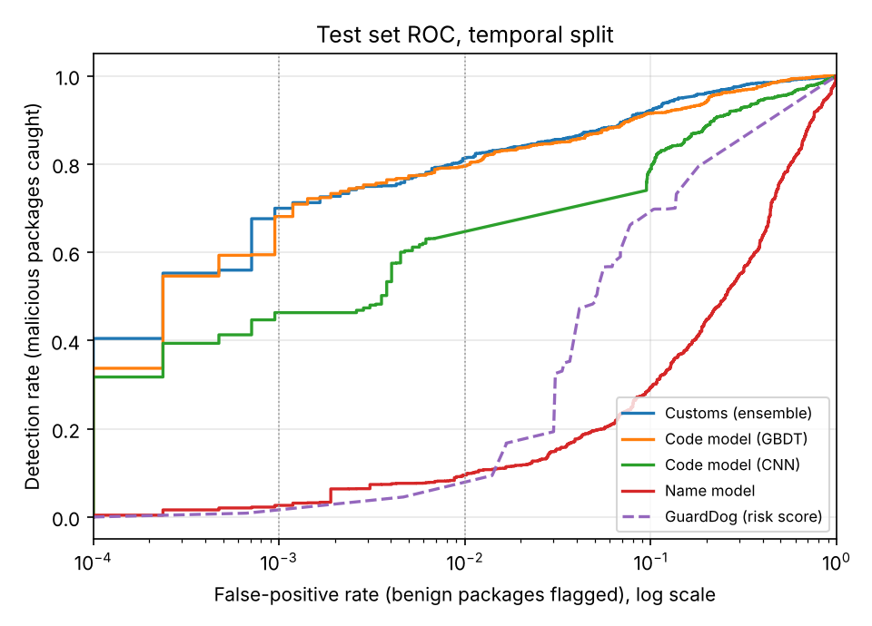
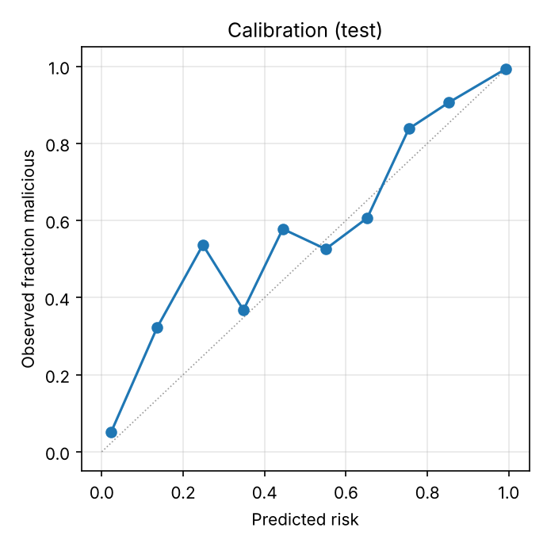
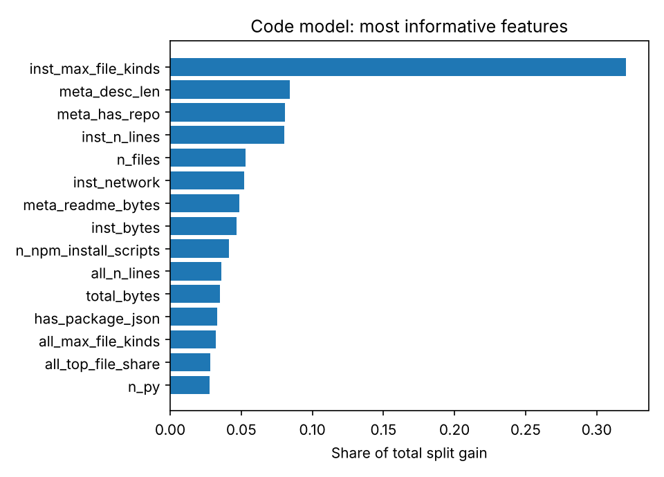

# Customs: evaluation report

Generated 2026-10-07T20:47:47+00:00 by `python -m customs_ml.report` from the artifacts of `python -m customs_ml.pipeline`. Every number below is on held-out test data with thresholds frozen on the validation split, unless a row says otherwise.

## Data

| Split | Malicious | Benign |
|---|---:|---:|
| train | 29,907 | 15,869 |
| val | 2,048 | 2,172 |
| test | 4,100 | 4,217 |

* **Temporal split.** Test malware was discovered on or after 2026-02-13; validation malware between 2025-12-10 and that date; training malware before. The model never saw a sample from the test period.
* **Second source.** Training malware also includes the dev half of MalRegistry (collected in 2022 and 2023, before the test period); its held-out half is a separate test, below. The training counts include augmented copies.
* **Benign packages** are split at random by near-duplicate cluster in the same proportions, sampled across three popularity tiers (top, mid, long tail) of PyPI and npm.
* **Near-duplicates.** MinHash LSH clusters (Jaccard about 0.7 on install-time token 5-grams) group malware campaigns. Clusters are the unit for benign splitting, sample weighting (1/sqrt(cluster size)) and for every confidence interval (cluster bootstrap, 1,000 resamples).
* **Canonicalization.** Both classes are repacked into identical deterministic tarballs before scanning, so archive format cannot leak the label.

## Headline (ensemble)

| Metric | Test value (95% CI) |
|---|---|
| ROC AUC | 0.972 (0.965 to 0.977) |
| PR AUC | 0.977 (0.971 to 0.982) |
| Detection rate at the **block** threshold (target FPR 0.1%) | 66.5% (62.5 to 70.3) |
| Realized test FPR at block | 0.07% (0.00 to 0.17) |
| Detection rate at the **warn** threshold (target FPR 1%) | 79.2% (76.0 to 82.5) |
| Realized test FPR at warn | 0.69% (0.44 to 0.94) |
| Detection at exactly 0.1% FPR on the test ROC (threshold-free) | 70.0% (53.7 to 75.4) |
| Detection at exactly 1% FPR on the test ROC (threshold-free) | 81.4% (77.2 to 84.6) |
| Brier score | 0.065 |
| Expected calibration error | 0.037 |

## Components

Each component's thresholds were chosen on validation at the same target FPRs.

| Model | ROC AUC | PR AUC | Recall at block | FPR at block | Recall at warn | FPR at warn |
|---|---:|---:|---:|---:|---:|---:|
| Customs (ensemble) | 0.972 | 0.977 | 66.5% | 0.07% | 79.2% | 0.69% |
| Code model (GBDT) | 0.968 | 0.974 | 67.8% | 0.09% | 79.3% | 0.92% |
| Code model (CNN) | 0.921 | 0.930 | 34.0% | 0.02% | 63.1% | 0.69% |
| Name model | 0.680 | 0.685 | 0.5% | 0.02% | 9.9% | 1.04% |

Stacking weights on component logits: code GBDT 0.94, code CNN 0.51, name 0.07 (fit on validation with 5-fold cluster-grouped cross-fitting; calibration and thresholds use out-of-fold scores). Each component logit is clipped to [-4, 4] before stacking, the bound with the best out-of-fold recall up to 1% FPR on validation. Without it, a few benign validation packages with extreme CNN logits set the block threshold well past its 0.1% target.

## Against GuardDog

[GuardDog](https://github.com/DataDog/guarddog) (Datadog's open-source scanner, v3.2) on the same canonical test archives, a fixed random sample of 1,500 malicious and 1,500 benign. Note the bias: most samples in Datadog's dataset were originally found with GuardDog's rules, so this comparison favours GuardDog.

| | GuardDog | Customs |
|---|---:|---:|
| ROC AUC (GuardDog risk score vs Customs risk) | 0.837 | 0.973 |
| Any finding: FPR | 18.0% | same FPR by construction |
| Any finding: detection rate | 79.4% | 96.1% |
| `high_risk` label: FPR | 5.0% | same FPR by construction |
| `high_risk` label: detection rate | 49.7% | 87.3% |

At GuardDog's own false-positive rate, Customs' detection-rate gain has a paired cluster-bootstrap 95% CI of 13.2 to 20.2 points. (For this comparison only, Customs' threshold is set on the test benign packages to match GuardDog's realized FPR; that is what matched-FPR means.)

## Where it is weak

| Slice | n malicious | n benign | ROC AUC | Recall at block | FPR at block |
|---|---:|---:|---:|---:|---:|
| ecosystem:pypi | 209 | 2,332 | 0.971 | 38.8% | 0.04% |
| ecosystem:npm | 3,891 | 1,885 | 0.964 | 68.0% | 0.11% |
| malicious:novel_campaigns | 3,550 | 4,217 | 0.971 | 67.0% | 0.07% |
| malicious:seen_campaigns | 550 | 4,217 | 0.975 | 62.7% | 0.07% |
| malicious:malicious_intent | 3,903 | 4,217 | 0.975 | 67.9% | 0.07% |
| malicious:compromised_lib | 197 | 4,217 | 0.901 | 37.6% | 0.07% |
| size:tercile_1 | 2,877 | 1,406 | 0.983 | 79.2% | 0.21% |
| size:tercile_2 | 747 | 1,405 | 0.952 | 49.0% | 0.00% |
| size:tercile_3 | 476 | 1,406 | 0.925 | 17.0% | 0.00% |

False-positive rate on benign packages by popularity tier:

| Tier | n | FPR at block | FPR at warn |
|---|---:|---:|---:|
| top | 574 | 0.00% | 0.17% |
| mid | 1,490 | 0.00% | 0.54% |
| tail | 2,153 | 0.14% | 0.93% |

`malicious:*` slices are each malicious subset against all benign test packages. `novel_campaigns` are test samples whose near-duplicate cluster has no member in training: the closest thing to a never-seen attack. Size terciles cut on benign source-line counts, to expose any small-package shortcut.

## What the misses are

Of 4,100 test malware packages, 852 fall below the warn threshold. Grouped by what the scanner saw:

| Scanner saw | n malicious | Missed | Miss rate |
|---|---:|---:|---:|
| Behavior indicators on the install surface | 2,960 | 308 | 10.4% |
| Indicators only outside the install surface | 482 | 278 | 57.7% |
| No behavior indicator anywhere | 658 | 266 | 40.4% |

A hand audit of 20 missed packages with no indicator anywhere (one per campaign, sampled at random) found 12 whose payload is a compiled binary (`.node`, `.exe`, `.so`, a macOS app), 1 that ships no code and depends on a malicious package (which the proxy scans on its own when the client fetches it), and 7 with no malicious content in the archive: two placeholders (a name reserved against dependency confusion that only raises an error, and the PyPA sample project) and five releases that read as clean. Those seven are label noise, so part of this row is not detectable by any scanner.

Binary-only packages (a compiled binary and under 50 lines of source) are a temporal blind spot: 155 test malware packages against 68 in training, and 78.1% of the test ones are missed at warn.
 Searching every packaged binary for infostealer and dropper strings (webhook and bot endpoints, browser credential stores, wallet and SSH key paths, anti-VM process names, autorun commands, IP-literal URLs) does not separate the classes: at least one appears in 4.9% of malicious and 3.2% of benign training binaries, and in 7.5% of malicious test ones. PyInstaller marks 34.5% of malicious training binaries but 2.0% in test, so a feature built on it would learn the past. Binary payloads stay with the policy rules (minimum package age, install scripts in new packages) rather than the classifier.

## Ablation: what does the code itself say?

The tree model retrained on 47 behavior features only (indicator counts and obfuscation statistics; no manifest metadata, sizes, or file counts):

| Feature set | ROC AUC | Recall at block | Recall at warn |
|---|---:|---:|---:|
| All features (before augmentation) | 0.976 | 73.0% | 81.1% |
| All features | 0.968 | 67.8% | 79.3% |
| Behavior only | 0.936 | 40.0% | 60.7% |

## Adversarial robustness

Held-out test malware rewritten as text (never executed), re-scanned and re-scored. Detection rate at the block and warn thresholds. *Seen* transforms are families the augmentation stage trained on (with donors from the training split; the test donors are different packages). *Unseen* ones were never used in training.

| Transform | Seen in training | Block (before) | Block (after) | Warn (before) | Warn (after) |
|---|---|---:|---:|---:|---:|
| none | n/a | 53.0% | 65.8% | 80.0% | 77.5% |
| string_split | no | 47.6% | 61.8% | 78.0% | 76.4% |
| base64_wrap | no | 68.4% | 84.9% | 91.6% | 94.0% |
| trojan_padding | yes | 35.4% | 62.9% | 68.0% | 77.9% |
| indirection | no | 52.5% | 65.8% | 79.9% | 77.5% |
| metadata_mimicry | yes | 38.6% | 55.5% | 63.2% | 74.6% |
| starjack | yes | 29.8% | 53.4% | 57.9% | 73.9% |

Clean test performance before and after augmentation:

| | ROC AUC | Recall at block | Recall at warn | FPR at block |
|---|---:|---:|---:|---:|
| Before | 0.979 | 53.9% | 80.0% | 0.00% |
| After | 0.972 | 66.5% | 79.2% | 0.07% |

## Name model

Logistic regression on name structure, typosquat distance to the 5,000 most popular packages, and hashed character n-grams, trained on OSSF malicious-package names reported before the validation cutoff against registry names, with every name in the code dataset held out.

| Ecosystem | Train names | Holdout ROC AUC | Holdout PR AUC |
|---|---:|---:|---:|
| pypi | 14,463 | 0.946 | 0.958 |
| npm | 192,090 | 0.980 | 0.983 |

The name model's job is the pre-download check (typosquats and names an agent hallucinated), before any archive exists to scan. Once the archive is scanned it adds nothing: its stacking weight is near zero. An earlier run gave it a clearly positive weight; that turned out to be a leak (the source dataset spells scoped npm names `@scope@name`, a form no benign name has), found by the end-to-end replay and fixed.

## End to end through the Rust firewall

`scripts/replay.py` serves held-out test archives from a local fake registry and requests each one through the real `customs serve` binary (nothing is installed or executed). This exercises the shipped scanner, Rust inference and policy engine together, and checks them against the Python evaluation.

| | Value |
|---|---:|
| Requests | 706 |
| Mean latency per request (scan + score + policy) | 60 ms |
| Malicious: blocked (HTTP 403) | 64.7% |
| Malicious: blocked or warned | 76.5% |
| Benign: blocked | 0.2% |
| Benign: warned | 0.8% |
| Decisions identical to the Python pipeline | 100.0% |
| Largest risk difference vs Python | 1.05e-07 |

### Latency under concurrent installs

`scripts/loadtest.py` serves 470 test archives (median 12 KB, 95th percentile 1670 KB) from a local fake registry and requests them through the firewall in enforce mode on a 4-core machine. Cold requests fetch, scan, score and decide; warm requests hit the verdict and artifact cache. Each concurrency level gets its own archives.

| Run | Clients | Requests/s | p50 ms | p95 ms | p99 ms |
|---|---:|---:|---:|---:|---:|
| Upstream directly (no firewall) | 1 | 564.2 | 1 | 4 | 11 |
| Cold | 1 | 26.6 | 15 | 112 | 559 |
| Cold | 4 | 44.3 | 26 | 472 | 1048 |
| Cold | 16 | 60.6 | 34 | 1253 | 1554 |
| Warm (cached) | 16 | 809.0 | 10 | 40 | 69 |

The server's own scan-and-score time averages 45 ms. Sequential cold latency grows with archive size (median 13 ms under 100 KB, 36 ms 100 KB to 1 MB, 111 ms over 1 MB). When 16 clients request the same uncached archive at once, 20 such bursts (320 requests) cost 20 scans: 294 requests waited on the scan already in flight and the rest arrived after it finished and hit the cache.

## Independent dataset: MalRegistry

The time-split test above uses one collector's malware. MalRegistry (the PyPI malware corpus from *An Empirical Study of Malicious Code In PyPI Ecosystem*, ASE 2023) was gathered separately. Its 11,630 unique archives are canonicalized like the corpus and scored by the shipped binary. Samples whose name appears in the training data (1,523) or whose code is a MinHash near-duplicate of training malware (7,600) are set aside; the rest are **novel**. Novel clusters are split in half: misses in the dev half were studied and drove scanner changes, the held-out half was never looked at. Both halves are frozen by archive hash, so every run below is measured on the same samples.

| Subset | n | Warn or block | Block |
|---|---:|---:|---:|
| All archives | 11,630 | 97.5% | 85.6% |
| Novel, dev half (in training) | 1,698 | 97.1% | 85.5% |
| Novel, held-out half | 2,174 | 91.9% | 40.1% |
| Novel, held-out, one per cluster | 660 | 83.0% | 64.7% |

Novel malware from another collector is much harder than the time-split test set. Thresholds move between retrains, so the comparisons below are made at matched false positive rates on the benign test split.

**Dev-half error analysis.** Most dev misses carried clear behavior indicators, but none on the install surface: the payload sat in a module that `setup.py` imports, or after a long run of blanks on one line, or in decoded data executed on the line that decodes it. The scanner now follows the package's own imports from setup-time files and has features for the other two. (Following imports from `__init__.py` as well was tried and made things worse: it pulls each benign library onto the install surface.)

| FPR | Dev, before | Dev, after | Held-out, before | Held-out, after |
|---:|---:|---:|---:|---:|
| 0.1% | 39.0% | 44.4% | 28.8% | 30.8% |
| 0.5% | 54.8% | 59.0% | 37.3% | 37.2% |
| 1.0% | 67.7% | 67.5% | 40.1% | 40.2% |

The changes helped the half they were designed on and barely moved the half that was held out. Error analysis on a handful of campaigns fits those campaigns; it is the held-out column that says how a fix generalizes, and these did not much.

**Name leakage check.** The name model is trained on OpenSSF malicious package names, and most MalRegistry names are among them (it is the same malware, reported). The in-domain test holds its names out of name-model training; here the binary was also run without the name model, using the ensemble's code-only fallback. Held-out recall at 0.1% / 0.5% / 1% FPR: 30.8% / 37.2% / 40.2% with the name model, 31.1% / 37.4% / 40.8% without. The name model carries almost no weight once code is scanned, so the leak does not inflate these numbers.

**Training on the second source.** The dev half (8,658 archives in 853 clusters, novel or not) was added to the training split and every model retrained; the held-out half (2,174 novel archives, 660 clusters, none sharing a cluster with the added data) was scored code-only.

| | Held-out recall at 0.1% FPR | at 0.5% | at 1% | In-domain ROC AUC | In-domain block recall |
|---|---:|---:|---:|---:|---:|
| Primary corpus only | 31.1% | 37.4% | 40.8% | 0.972 | 57.4% |
| Plus MalRegistry dev half | 40.2% | 48.7% | 51.7% | 0.970 | 57.7% |

Held-out recall at 0.5% FPR by share of dev clusters added: 25% (213 clusters): 43.0%, 50% (426 clusters): 46.1%, 100% (853 clusters): 48.7%.

The shipped models include the dev half (pipeline stage `malregistry`). Rerun through the binary, they score the held-out half at 44.8% / 76.0% / 92.1% (code only, 0.1% / 0.5% / 1% FPR).

**Read the campaign-weighted numbers.** Weighting each held-out campaign equally, the shipped models catch 72.3% / 80.3% / 83.5% at the same rates. One campaign holds 901 near-identical archives (41.4% of the held-out half) with code-only risk near 0.91, so per-archive recall jumps by that share whenever a retrain moves that score across a threshold; per-archive numbers between runs are only comparable when that campaign stays on the same side.

## Experiment: release diff model

A hijacked release of a popular library is mostly the previous release plus a payload, so the payload is a small share of the package. This experiment scores only what a release adds: files new since the previous release, plus the new lines of changed files (`customs-scan delta`). The model is trained on 19,333 benign release pairs and as many synthetic compromises (training-split malware payloads injected into benign releases in seven ways), and tested on the real compromised releases, which never enter training.

| | Base model | Diff model |
|---|---:|---:|
| ROC AUC, real compromised test releases (n=178) | 0.894 | 0.881 |
| ROC AUC, synthetic compromises (test) | n/a | 0.994 |

| Test FPR | Base recall | Base + diff recall |
|---:|---:|---:|
| 0.1% | 49.4% | 39.3% |
| 0.5% | 66.9% | 61.2% |
| 1.0% | 74.7% | 66.3% |

At 0.5% FPR the two models disagree often: 57 releases are caught by both, 62 only by the base model and 8 only by the diff model (among them litellm 1.82.7 and 1.82.8, which the base model scores far below its warn threshold). The diff model misses releases whose previous version was already compromised, since the payload is then not new.

Combined at a matched false positive rate (each model's score turned into a tail probability on benign validation pairs, then the maximum), the pair gains -10.1 points at 0.1%, -5.6 points at 0.5%, -8.4 points at 1.0% FPR, on 178 releases. Taking the maximum of two scores spends the false positive budget on both, which costs recall at the block operating point (49.4% to 39.3% at 0.1%). The diff model is therefore not part of the shipped decision: the combination loses recall at every rate measured.

## Release history rules on compromised npm releases

The proxy's release history rules (`provenance_dropped`, `install_script_added`, `publisher_changed`, `dormant_revival`, `version_anomaly`, `nonregistry_dependency_added`, `young_dependency_added`) read registry metadata, not code, so they can catch hijacked releases the model scores low. `python -m customs_ml.history_eval` replays them on every compromised npm release in the corpus with an earlier release (327 releases of 280 packages) and on every release from the last 2 years of 260 benign npm packages from the corpus (14,897 releases). Most compromised versions were unpublished (310 of 327): their publish time survives and their install scripts and dependencies come from the archive, but whether they carried provenance and who published them is gone, so those two rules give a range (unknown counted as silent, then as firing). The dependency rules compare with the previous release's dependencies, which are gone too when that release was itself unpublished, so they give a range as well.

| Rule | Default | Compromised releases | Benign releases | Benign packages alarmed in the window |
|---|---|---:|---:|---:|
| `provenance_dropped` | warn | 0.3% to 54.4% | 0.19% | 5.0% |
| `install_script_added` | block | 69.1% to 72.2% | 0.03% | 0.8% |
| `publisher_changed` | warn | 0.3% to 95.1% | 1.06% | 40.0% |
| `dormant_revival` | warn | 16.2% | 0.50% | 26.9% |
| `version_anomaly` | off | 3.1% | 0.09% | 3.5% |
| `nonregistry_dependency_added` | block | 8.6% to 39.8% | 0.00% | 0.0% |
| `young_dependency_added` | block | 6.4% to 42.2% | 0.01% | 0.4% |
| any rule on by default | | 83.8% to 100.0% | 1.62% | |

On the 165 compromised releases in the test period, together with the model:

| | Model alone | With the rules |
|---|---:|---:|
| Warned or blocked (any default rule) | 67.3% | 97.6% to 100.0% |
| Blocked, `install_script_added` only | 40.0% | 76.4% to 77.0% |
| Blocked, every blocking rule | 40.0% | 95.2% to 98.2% |

`install_script_added` is the rule that earns its place: it fired on 4 of 14,897 legitimate releases (0.03%, under the block budget of 0.1%) and on at least 69.1% of compromised ones, because the classic takeover adds a `postinstall` and established packages rarely change theirs. It compares with the previous release and, when that shows no change, with the newest release at least a day older: attackers often publish several malicious versions within hours, and each one matches the one before it. It therefore blocks by default. `publisher_changed` is the noisiest rule on by default (1.06% of releases; 40.0% of packages over the window, since large projects rotate release managers), and its value on compromised releases cannot be measured once they are unpublished, so it stays at warn. Provenance cannot be judged from what survives: of the 17 compromised releases still listed, 3 followed a release with provenance, and 2 of those carry valid provenance themselves, because the attacker published through the project's own CI. A takeover by stolen token drops provenance; a takeover of the build does not.

The two dependency rules target waves whose payload arrives through a dependency, not the package's own files, so the scanner sees nothing in the archive: a new `optionalDependencies` entry pointing at a GitHub commit, or a new dependency on a package the attacker published days earlier. `nonregistry_dependency_added` fires when a git, URL or file dependency is new or changed since the previous release; `young_dependency_added` fires when a new dependency is not on the registry, or was first published less than 7 days before the release by someone who maintains or publishes none of the package's releases (a maintainer's own new platform package is routine). They fired on 8.6% to 39.8% and 6.4% to 42.2% of compromised releases, and on 0 and 1 of 14,897 legitimate ones. Of the 54 test-period compromised releases the model lets through, they catch 28. Both block by default.

Takeovers come in waves, one attacker working through every package a stolen account or token can publish. Grouping the test-period releases by npm scope, or by name prefix for unscoped packages, shows which waves each layer stops (groups of at least 3 releases; blocked means under the default policy):

| Group | Releases | Packages | Model blocks | A blocking rule fires | Blocked |
|---|---:|---:|---:|---:|---:|
| `@emilgroup/*` | 21 | 19 | 21 | 18 | 21 |
| `@mastra/*` | 19 | 19 | 0 | 19 | 19 |
| `@antv/*` | 18 | 18 | 17 | 18 | 18 |
| `@redhat-cloud-services/*` | 16 | 16 | 11 | 16 | 16 |
| `autotel-*` | 11 | 8 | 0 | 11 | 11 |
| `@tanstack/*` | 7 | 7 | 0 | 7 | 7 |
| `awaitly-*` | 7 | 5 | 0 | 7 | 7 |
| `@automagik/*` | 6 | 1 | 0 | 6 | 6 |
| `@openwebconcept/*` | 6 | 2 | 6 | 6 | 6 |
| `@opensearch-project/*` | 4 | 1 | 0 | 4 | 4 |
| `mgc` | 4 | 1 | 0 | 0 | 0 |
| `pgserve` | 4 | 1 | 0 | 4 | 4 |
| `react-*` | 4 | 4 | 3 | 4 | 4 |
| `@cap-js/*` | 3 | 3 | 0 | 3 | 3 |
| `@uipath/*` | 3 | 3 | 0 | 3 | 3 |
| `@vapi-ai/*` | 3 | 1 | 0 | 3 | 3 |
| `node-*` | 3 | 3 | 0 | 2 | 2 |

The model and the rules fail in different places: a wave that ships its payload in the archive is the model's to catch, and a wave that pulls it in through a new install script or dependency is the rules'. A wave with neither (an obfuscated payload in a file the install surface does not reach, published by the usual account with no change to scripts or dependencies) gets past both.

The Python replay agrees with the proxy's own `customs check` on 107 of 107 benign releases sampled across the rules (every rule set to warn).

## Prospective study: live PyPI traffic

Every number above is about malware someone already found. Here the frozen models ran forward in time: `scripts/live_watch.py` followed PyPI's changelog and sent every new release published during the window through a running `customs serve` (downloaded and scanned in memory, never installed). Outcomes were read off later from PyPI itself (the project was removed) and from OpenSSF malicious-package reports.

Window: 2026-10-07T07:56:21Z to 2026-10-07T16:49:47Z (UTC).

| Decision | Releases | Later removed from PyPI | OpenSSF report |
|---|---:|---:|---:|
| allow | 4,644 | 7 | 0 |
| warn | 4 | 0 | 0 |

4,648 of 4,649 releases were scanned (513 from projects created during the window).

The window is hours long, and malicious uploads usually stay up for days, so the removal columns are a floor. What the window does measure is the alert load on real traffic: 4 of 4,648 fresh releases (0.1%) were warned or blocked, the rate a user installing brand-new releases would see.

## Retrain variance

The tree model and the CNN retrained with 5 seeds (7, 11, 23, 42, 101) on identical data, each stacked and thresholded the same way as the shipped model. A change between two training runs smaller than these ranges is not evidence that anything improved or regressed.

| Test metric | Mean | SD | Min | Max |
|---|---:|---:|---:|---:|
| ROC AUC | 0.968 | 0.001 | 0.968 | 0.969 |
| Recall at block | 66.0% | 3.4 pts | 61.5% | 69.9% |
| FPR at block | 0.14% | 0.10 pts | 0.07% | 0.31% |
| Recall at warn | 79.4% | 0.5 pts | 78.7% | 79.9% |
| Recall at exactly 0.1% FPR (test ROC) | 66.9% | 3.6 pts | 63.1% | 71.2% |
| Compromised libraries: ROC AUC | 0.844 | 0.007 | 0.832 | 0.851 |
| Compromised libraries: recall at block | 39.5% | 3.7 pts | 35.5% | 43.1% |
| PyPI malware vs all benign: ROC AUC | 0.941 | 0.007 | 0.935 | 0.952 |
| PyPI malware: recall at block | 43.0% | 4.8 pts | 39.2% | 51.2% |

ROC AUC and recall at warn barely move between seeds. Everything at 0.1% FPR is a tail statistic: the block threshold rests on two or three of about 2,000 benign validation packages, and the threshold-free row on four of 4,217 benign test packages, so both move several points between retrains: recall at block spans 8.4 points across these seeds, and a difference at the block rate between two runs needs to exceed that before it says anything about the model. Training is reproducible: the same seed in a fresh process (different string hash seed) produces bit-identical tree and CNN outputs, after the CNN vocabulary stopped breaking document-frequency ties by set order.

Averaging the tree and CNN logits of several seeds before stacking (seed bagging), over every subset of the seeds of each size:

| Seeds averaged | Subsets | Recall at block (min to max) | FPR at block (min to max) | Recall at warn | ROC AUC |
|---:|---:|---:|---:|---:|---:|
| 1 | 5 | 66.0% (61.5% to 69.9%) | 0.14% (0.07% to 0.31%) | 79.4% | 0.968 |
| 2 | 10 | 66.4% (59.8% to 68.9%) | 0.12% (0.07% to 0.24%) | 79.8% | 0.967 |
| 3 | 10 | 66.9% (63.1% to 69.1%) | 0.10% (0.07% to 0.17%) | 80.2% | 0.966 |
| 4 | 5 | 67.8% (67.4% to 69.0%) | 0.09% (0.07% to 0.12%) | 80.3% | 0.966 |
| 5 | 1 | 67.8% (67.8% to 67.8%) | 0.09% (0.09% to 0.09%) | 80.6% | 0.965 |

Bagging mostly steadies the block threshold: single seeds realize between 0.07% and 0.31% FPR at block, the full bag 0.09%, and recall at block moves from a 66.0% mean to 67.8%, inside the single-seed range. It costs one tree model and one CNN per seed at serve time, so the shipped model stays a single seed.

Exported model sets scored on today's features (the current scanner's view of the test set), which separates what a scanner change did to the test data from what retraining did to the model:

| Models | ROC AUC | Recall at block | FPR at block | Recall at exactly 0.1% FPR | Compromised libraries ROC AUC |
|---|---:|---:|---:|---:|---:|
| before re-root (shipped in 6754e4a) | 0.9691 | 67.6% | 0.12% | 63.4% | 0.856 |
| after re-root (seed 7) | 0.9694 | 66.5% | 0.07% | 68.5% | 0.852 |

## Calibration

Risk is calibrated (Platt scaling on out-of-fold validation scores) at the class balance of the evaluation data, roughly even. In the wild malware is far rarer, so treat the risk as a ranking with frozen thresholds rather than as the literal probability that a random package from the registry is malicious.

## Limitations

* **Label source bias.** Malware comes from Datadog's dataset, mostly found by GuardDog's heuristics, so the positives over-represent what heuristics already catch. Novel techniques that neither GuardDog nor these features describe are under-represented in both training and test.
* **Benign label noise.** Long-tail benign packages could include undiscovered malware. They were filtered against all 234K OSSF reports and required to be at least 90 days old, which removes most of it but not all.
* **Static analysis only.** Code that fetches its payload at runtime from a clean host, or hides logic in native binaries, gives little static signal. The policy rules (minimum age, nonexistent names, install scripts in new packages) are the backstop.
* **Adaptive attackers.** The robustness table covers a handful of cheap evasions. An attacker who can query the model can do better; published work on prompt and malware detectors shows adaptive attacks break most static classifiers. Customs is one layer, not a guarantee.

