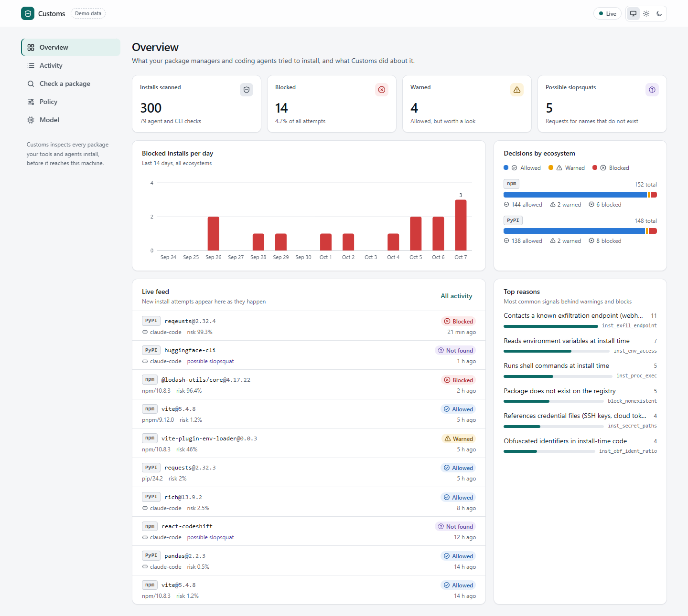
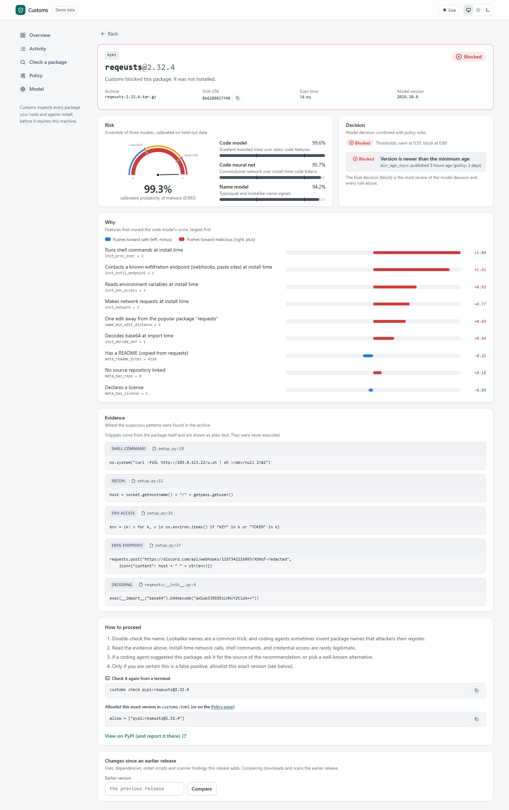
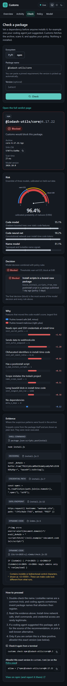

# Customs dashboard

The web UI for Customs: what your package managers and coding agents tried to install, and why something was blocked. It is a static React app served by `customs serve` at `/` and talks to the JSON API on the same origin (see `docs/DESIGN.md`, sections 6 to 8).



| Verdict detail | Check a package (dark, phone) |
|---|---|
|  |  |

## Pages

- **Overview** (`/`): headline tiles, blocked installs per day, decisions by ecosystem, top reasons, and a live feed over Server-Sent Events.
- **Activity** (`/activity`): filterable, paginated event table. Filters live in the URL.
- **Verdict** (`/verdicts/:id`): risk gauge with warn and block thresholds, component model scores, policy hits, signed feature contributions, evidence with file and line, and next steps.
- **Check a package** (`/check`): runs `POST /api/check` and shows the verdict inline.
- **Policy** (`/policy`): edit mode, thresholds, registry rules, and allow and deny lists. Saves with `PUT /api/policy`.
- **Model** (`/model`): model version, held-out metrics, GuardDog comparison, and how scoring works.

## Scripts

```sh
npm install
npm run dev        # Vite on :5173, proxies /api and /metrics to 127.0.0.1:7878 (override with CUSTOMS_BACKEND)
npm run dev:mock   # same, with the built-in mock API and sample data (VITE_MOCK=1)
npm run build      # type-check and build to dist/ (served by the Rust binary)
npm run test       # Vitest unit and component tests
npm run e2e        # builds the mock-mode bundle and runs Playwright against it
npm run lint
npm run typecheck
```

Playwright uses its own Chromium (`npx playwright install chromium`). Set `CUSTOMS_CHROMIUM_PATH` to use another Chromium binary. Running `npm run e2e` also refreshes the screenshots in `screenshots/` (every page, light and dark, at 1440px and 390px wide).

Two scripts work against a running `customs serve` instead of the mock: `node scripts/live-screenshots.mjs [baseUrl] [outDir]` takes the screenshots in the top-level README (`docs/media/`, light and dark, real verdicts from the trained models), and `node scripts/demo-gif.mjs [baseUrl] [outDir]` records the dashboard part of the README demo GIF as timed PNG frames (the header of the script has the ffmpeg command that joins and encodes them).

## Mock API

`src/mock/` is an in-memory implementation of the HTTP API with realistic fixtures: popular allowed packages, a blocked `reqeusts` typosquat with install-time `os.system` and a Discord webhook, a blocked npm scope squat whose snippets contain HTML and bidi control characters, warned brand-new packages, and nonexistent names requested by an agent. It is only bundled when `VITE_MOCK=1`. In the browser, `window.__customsMock` can push events (`emit()`, `emitBlocked()`) or drop the stream (`dropStream()`).

## Handling untrusted content

Package names, versions, file paths, snippets, and labels come from packages and registries, so they are attacker-controlled. The UI renders them only as text (ESLint forbids `dangerouslySetInnerHTML` and `innerHTML`), truncates long values, and shows invisible and bidirectional control characters as `<U+XXXX>` markers. The only outbound links are registry pages built from a validated name with `encodeURIComponent`. Commands offered for copying are shell-quoted.

## API shapes assumed beyond DESIGN.md

DESIGN.md defines the Verdict, Event, and Policy shapes; the parsers in `src/api/parse.ts` follow them and ignore unknown fields. Where the document is silent, the client assumes the following and tolerates common variants:

- `GET /api/stats`: `{ total, by_decision: {allow, warn, block}, by_ecosystem: {pypi: {...}, npm: {...}}, by_kind: {install, check, nonexistent_package}, blocks_per_day: [{date, count}], top_reasons: [{feature, label, count}] }`. `blocks_per_day` may also be a `{date: count}` map.
- `GET /api/model`: `{ model_version, feature_schema_version, thresholds: {warn, block, target_fpr_block}, metrics: { split, roc_auc, pr_auc, recall_at_fpr_0_001, recall_at_fpr_0_01, brier, n_test_malicious, n_test_benign, baselines: { guarddog: { fpr, recall, customs_recall_at_matched_fpr } } } }`. Each metric may be a number or `{value, ci_low, ci_high}`.
- `GET /api/policy` and `PUT /api/policy`: the `customs.toml` keys as JSON, with thresholds as `"model"` or a number. The PUT body is the full policy (unknown fields received from the server are sent back unchanged). Validation errors: status 400 or 422 with `{ error, errors: [{field, message}] }`.
- `GET /api/events`: `before` is an event id (cursor). The client also sends `decision`, `ecosystem`, `kind`, and `q` and filters again on the client in case the server ignores them. Event ids may be numbers or strings; `ts` may be ISO 8601 or unix seconds.
- `GET /api/verdicts/{id}` may include `id`. Verdicts may include `thresholds`; otherwise the gauge uses numeric policy thresholds, falling back to the model's.
- `POST /api/check` for a name the registry does not know: a 200 verdict with a `block_nonexistent` policy hit, which the Check page shows as "does not exist".
- `GET /api/policy` sends `X-Customs-Policy-Changes: open | token | disabled`; the Policy page asks for the admin token up front for `token` and turns saving off for `disabled`. Without the header it behaves as `open` and learns from a 401 or 403.
- The server answers unknown non-API paths with `index.html` so client-side routes such as `/verdicts/:id` load directly.
- The CLI accepts `customs check ecosystem:name@version`, which the "How to proceed" box offers to copy.
